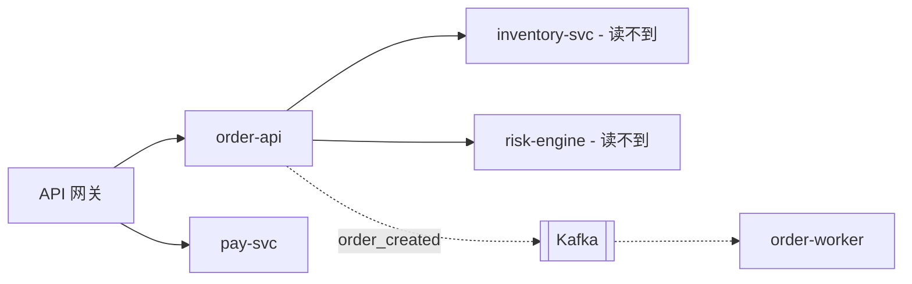

# 先画出系统的构成地图

**这个技能只做一件事：在深入任何一个仓库之前，先把整个系统由哪些服务组成画出来。** 地图画完、选定深入哪个服务，再交给 `explain-project`。

**地图的单位是服务，不是仓库。** 仓库只是服务的代码住处：一个仓可能装着好几个服务，一个服务也可能散在几个仓里（前后端分仓、单独的 SDK 仓、配置仓）。按仓库画，这两种情况都会被抹平。

新人手上通常只有一个仓库地址，于是默认"这个仓库 = 这个系统"。这个默认在两个方向上都会错，而且错法相反：

- **系统比仓库大**：后端由好几个服务拼成，他手上这个只是一块。照一个仓讲，"全流程"是断的——请求从哪儿来、去哪儿，答案在别人仓里
- **仓库比系统大**：一个仓塞着十几个项目，只有一两个跟这条业务线有关。照整个仓讲，一大半跟他无关，还容易把没人维护的老项目当成现役系统

这两种错**读得更仔细也避不开**——是范围问题，不是深度问题。

## 三条线索，互相印证

地图不能只从手上这个仓库里拼。三条线索各看到系统的一面，只看一条一定会漏：

| 线索 | 看到的是什么 | 可信度 |
|---|---|---|
| **本地代码** | 这个仓自己承认的依赖和入口 | 可信 |
| **代码托管平台**（GitHub / GitLab） | 这条产品线一共有哪些仓、谁在维护、哪些还活着 | 仓存在是可信；它属不属于这个系统，多半是推断 |
| **线上运行环境** | 真正在跑的是哪些服务、请求实际怎么走 | 实测 ⭐ |

三条线**对不上的地方，才是地图上最值钱的标注**：

- 线上在跑、代码里找不到 → 仓库外还有东西，回平台上找它的仓
- 代码里有、线上没看到 → 可能已下线，也可能只部署在别的环境
- 平台上有仓、代码和线上都没提到 → 废弃仓或边缘工具，在表里标出来，但别展开

### 线索一：本地代码

从新人手上那个仓库往两个方向扩。

**往外扩——找出它依赖的其他服务：**

- **出站配置**：host / endpoint / url / appkey 类配置项指向的都是仓库外的依赖。通读一遍配置和环境变量，比读任何架构文档都快
- **MQ topic / 队列名**：名字里带别的服务名的（`xxx_file_transfer` 这种），对面多半是兄弟服务
- **注释和常量里点名的服务**：拿产品线的服务名前缀 grep 一遍往往能捞到

**往内收——判断这个仓里哪几块才属于这个系统：**

- **构建描述符有几个**：多个 `pom.xml` / `go.mod` / `Cargo.toml`、`package.json` 的 workspaces、`BUILD` 文件——一个通常对应一个可独立部署的单元
- **流水线里真正部署出去的是哪几个**：`.gitlab-ci.yml` / `Jenkinsfile` / `Dockerfile*` / `k8s/` 里的服务名和镜像名是最硬的证据，没进流水线的目录多半是死的
- **哪些子目录有自己的入口**：main / Application / 路由注册，逐个子目录看一遍
- **`CODEOWNERS` / `OWNERS`**：哪些目录归你们团队
- **`git log` 近一年动过的才是活的**：几年没提交的别当现役系统讲，但要在组成表里标"已停更"，免得新人自己翻到误以为是主线

### 线索二：代码托管平台

本地代码只能看到这个仓认识谁，平台能看到这条产品线一共有谁。

- **列出组织 / 团队的全部仓库**：
  - GitHub：`gh repo list <org> --no-archived --source -L 200`；只看某个团队的：`gh api /orgs/<org>/teams/<team>/repos`；按主题筛：加 `--topic <topic>`
  - GitLab：`glab repo list -g <group> -G`（`-G` 连子组一起列）
- **按名字前缀、topic、描述初筛**，再看每个候选仓的 README、`CODEOWNERS` 和最近一次提交时间，判断它活没活着、归谁
- **全组织代码搜索**——拿本地代码里出现的服务名、MQ topic、域名去搜，看它们还出现在哪些仓里：
  - GitHub：`gh search code "<关键字>" --owner <org>`
  - GitLab：`glab api "groups/<group>/search?scope=blobs&search=<关键字>"`。组级代码搜索要实例开了高级搜索，没开就把初筛出的仓逐个 clone 下来 grep
- **调用关系要两头对上**：本地代码里出现的每个外部 host、每个 topic，都应该在平台上找到对应的仓。找不到的记进待确认清单

在平台上只读：list、search、clone，不建分支、不提 issue、不做任何写操作。

### 线索三：线上运行环境

代码说的是"应该怎么走"，线上说的是"实际怎么走"。这条线最硬，也最常被跳过——因为它一般不在你手上，得问用户要。

能看的地方，按信息密度从高到低：

- **链路追踪 / APM 的服务拓扑**（SkyWalking、Jaeger、Datadog 这类）：一张图就是现成的服务地图，比任何从代码推出来的都准
- **服务注册中心**（Nacos、Consul、Eureka）或 **k8s**（`kubectl get deploy,svc -n <namespace>`）：真正在跑的服务清单
- **API 网关路由**（APISIX、Kong、Nginx 配置）：对外地址到底被转给了哪个服务
- **访问 URL / 域名**：打一次，看响应头和错误页出自哪一层（具体手法见 `explain-project` 阶段二的反向校验）

一律只读：只用 get / describe / 查询，不 apply、不 delete、不重启；打接口只打读接口和故意打错的探测。

## 一次问清用户

**先把自己能查的查完**——本地代码、有权限的平台——再把**只有用户能给的**东西一次问清。别挤牙膏，也别拿自己查得到的东西去问人：

> 为了先把整个系统画清楚，想确认几件事（没有的直接说没有）：
> 1. 线上或测试环境有在跑的服务吗？访问地址 / 域名是什么？
> 2. 代码托管在哪——GitHub / GitLab 的地址和组织（组）名？我这边有没有权限？
> 3. 有没有能看的链路追踪、服务注册中心、k8s namespace 或网关配置？
> 4. 有没有现成的架构图或 wiki？（我只当线索用，会拿代码和线上核对）

用户给不了的，照样往下画，缺口记进待确认清单——**地图允许有空白，但空白要标出来**。

## 产出：系统构成地图

两样东西：一张**组成表**，一张**服务拓扑图**。

**组成表**，一个服务一行：

| 服务 | 代码在哪 | 线上入口 | 属于这个系统吗 | 本次聚焦吗 | 职责 | 读得到吗 |
|---|---|---|---|---|---|---|
| `order-api`（你手上这个） | 本仓 | `api.example.com/v1/orders` | 是 | **聚焦** | 对外 HTTP 入口 | ✅ 已读 |
| `order-worker` | `order-worker` 仓 | 无对外入口 | 是 | 否 | 异步履约，消费 MQ | ✅ 已 clone |
| `pay-svc` | `pay-svc` 仓 | `api.example.com/v1/orders/{id}/pay`，网关直转 | 是 | 否 | 支付 | ✅ 已 clone |
| `inventory-svc` | 别的团队，仓名待确认 | 仅内网 | 是 | 否 | 库存扣减 | ❌ 读不到，只讲契约 |
| `risk-engine` | 别的团队 | 仅内网 | 是 | 否 | 风控 | ❌ 读不到 |
| `legacy-crm` | 本仓 `legacy-crm/` 子目录 | 无 | **否** | 否 | 三年没提交的老项目 | — 不读 |

表里每一行都要说清**凭什么这么判**（线上看到了它 / 它在流水线里 / 平台上归谁 / 近一年有没有提交），按下面的级别标好证据。判不准的行标"推断"并记进待确认清单，别硬塞进"是"或"否"。

**服务拓扑图**，只画服务这一级，不画类：

同步调用画实线，异步（MQ、定时任务）画虚线；读不到的服务照样画上去并标出来；网关要画——新人最容易漏的就是"请求在到达任何一个服务之前，已经被网关分走了"。

## 「范围」和「聚焦」是两件事，别混着说

这张表把服务分成三层，后面每一步该读到什么深度，都以这三层为准。**这两个词含义固定，不要换着用**：

| 层 | 判据 | 后面怎么对待它 |
|---|---|---|
| **范围内 + 聚焦** | 属于这个系统，且是本次要讲透的那一个 | 交给 `explain-project` 走完整套导览 |
| **范围内 + 不聚焦** | 属于这个系统，但这次不深挖（兄弟服务、别的团队维护的服务） | 只给轮廓和契约：读得到的给顶层目录树，读不到的只讲接口契约。**不深追它的内部实现** |
| **范围外** | 不属于这个系统（同仓的无关项目、别的产品线） | 一行都不读，也不出现在后面任何一张表和图里 |

最容易搞错的是中间那层：它**在范围内**，所以链路跨到它那儿时必须讲清楚去了哪儿、传了什么；但它**不聚焦**，所以不要跑去把它的代码也通读一遍。"跨出边界要标注"和"不要在多个仓库间横跳"说的正是这一层的两面，不矛盾。

**读不到的服务怎么办**——权限没开、跨团队、代码在别的平台，都很常见。能 clone 就 clone，有代码搜索就搜；拿不到就当**外部依赖**讲，只讲契约：调它什么、传什么、返回什么、失败了会怎样——这些从调用方代码里读得出来。同时按三件套记进待确认清单。**不要假装它不存在**，更不要凭服务名猜它内部实现。

## 地图画完，选择深入哪个服务

地图是廉价的，深讲是贵的。地图给完，让用户选：

> "这个系统由这几个服务组成，你手上的是 X。先深入哪一个？"

可以给建议，优先级依次是：**他接下来要改的那个 > 核心链路的起点 > 他手上的那个**。不回答就默认聚焦他手上那个。

---

## 判断依据要标清楚（与 explain-project 同源，改一处要改两处）

组成表里每一行的判断，按可信度标级别，让人知道哪些能直接信：

| 级别 | 依据 | 怎么说 |
|---|---|---|
| 实测 ⭐ | 打过真实接口 / 跑过真实流程 | 直接陈述 + 贴响应片段。与代码推断冲突时以实测为准 |
| 可信 | 读到了代码 | 直接陈述 + `文件:行号` |
| 参考 | 只有文档/注释 | 标明出处 + "未在代码中验证" |
| 推断 | 我根据模式推的 | 说明推断依据 + 给出验证方法 |

**"代码里没有"有两种可能——你没找到，或者它不在这个仓库。别默认是前者。** 默认前者，就会一直在错的仓库里翻；把后者摆上台面，才会想到去问"是不是还有别的服务"。

## 待确认清单（与 explain-project 同源，改一处要改两处）

判不准的行不要硬塞进"是"或"否"，记进清单交给对方去问人。**区分两种，处置方式正相反**：

- **查不到**（不在任何我能访问的地方：别的团队的仓库、外部系统的口头约定）→ 写进清单，**必须附上"我查过哪些地方"**
- **没查**（我能查但这次没做）→ **自己去查，不许写进清单**。把自己能解决的事塞给别人，是在占用比你贵得多的时间

清单里每条写三件事，缺一条就没法直接拿去问人：**现象**（看到了什么，附 `文件:行号` 或实测响应）、**我查了什么**、**卡在哪**（具体哪一步推不下去，以及我猜是什么，标明是猜的）。

## 产出放哪里（与 explain-project 同源，改一处要改两处）

组成表是要给人反复回看的，别只打在对话里：**有 artifact 工具就写进 artifact**，没有就写成 Markdown 文件放在**仓库之外**（兄弟目录、home 下的笔记目录、临时目录），把绝对路径告诉用户。

**禁止把它写进仓库里**——这是个人笔记不是项目资产，极易被误提交，还会污染别人的 `git status`。加 `.gitignore` 不是解法，那也是在改仓库。

如果接下来要交给 `explain-project`，**用同一份产出**，让它往后追加，不要另起一份。

## 反面模式

- ❌ 只从本地代码拼地图，不上平台找、不问线上——三条线索只看了一条
- ❌ 以仓库为单位画地图——一个仓装多个服务、一个服务散在多个仓的情况全被抹平
- ❌ 拿仓库边界当系统边界：把"仓库里没有"当成"系统里没有"，或把一个仓里十几个项目全讲一遍
- ❌ 自己查得到的不查就去问用户，或者把问题一个一个挤牙膏地问
- ❌ 对线上环境、k8s、网关、代码平台做任何写操作
- ❌ 组成表只列名字，不说凭什么判定它属于这个系统；读不到的服务就当它不存在
- ❌ 画完地图不交棒，自己接着深入讲某一个仓——那是 `explain-project` 的活
- ❌ 把地图写进被分析的仓库里

## 画完之后

把组成表、拓扑图和三层定界交给用户，确认深入哪个服务，然后**调用 `explain-project`，把这份产出和聚焦结论一起带过去**。它会对聚焦的那个服务走完整套导览（链路跨到范围内其他服务时只讲轮廓和契约）：项目定位 → 代码地图 → 对外接口 → 分层架构 → 核心链路 → 数据模型 → 一次真实请求 → 技术方案 → 关键源码。
