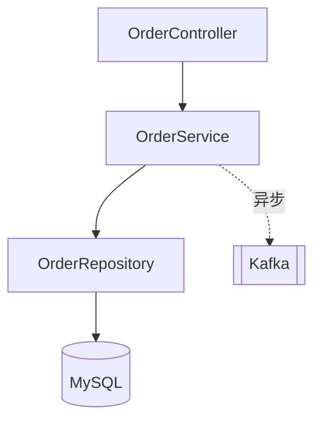
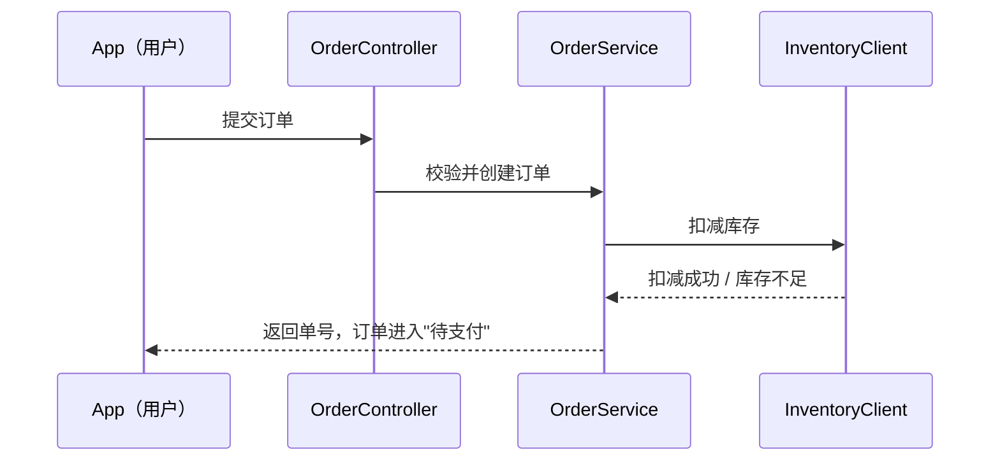
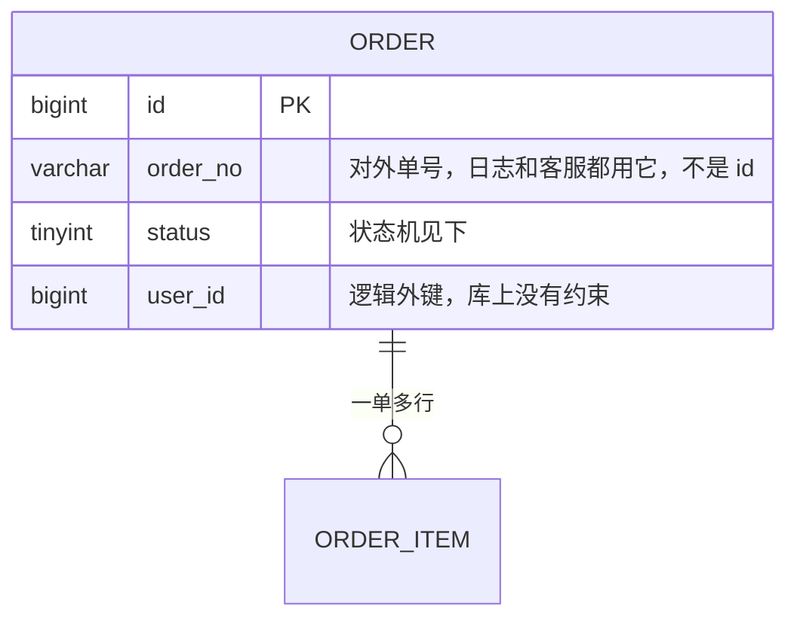
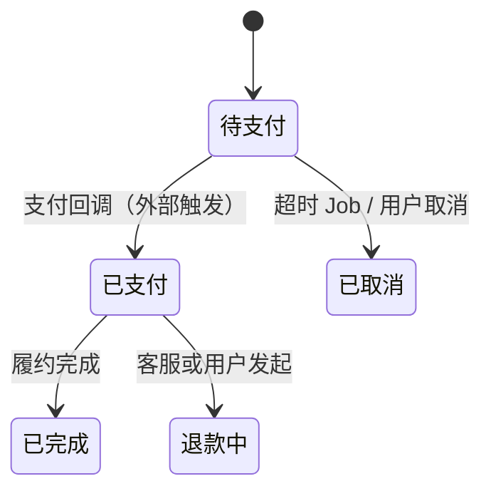

# 新人项目导览

## 这个技能要解决什么

听众是**刚进组的研发**：他会写代码，但对这个项目一无所知。他的真实困境不是"没有文档"，而是**已有的一切都默认你已经懂了**：文档用黑话解释黑话，代码没有入口线索，老员工三句话带过的地方全是坑。

所以本技能的产出是**一次分阶段、可追问、能听懂的导览**：内容分阶段写进一份 artifact（或落盘文件），对话里带着他一段段走、随时停下来答疑。它同样是一份文档，但不是那种一次性甩过去、写给老员工看的架构文档。

判断标准只有一个：一个昨天刚入职的人，听完能不能自己定位到一个具体功能的代码位置并说清它的数据流向。

## 四条贯穿全程的纪律

**1. 先读够再开口。** 只读了几个文件就总结架构，会给出看似合理实则错误的结论——而新人**没有能力分辨你错在哪**，误导成本远高于说"我不确定"。覆盖度自检：如果某个体量不小的目录你一行都没看过，要么去看，要么在讲之前明确说"这块我没覆盖"。

**2. 代码是唯一可信数据源，文档和注释只是参考线索。**

README、Wiki、接口文档、需求文档、代码注释都会过期，而且**过期得悄无声息**——写的人不会回来更新，但代码一直在跑。新人被过期文档误导，往往要一两周才发现。

- 任何结论**优先从代码得出**，并附 `文件:行号`
- **只有代码里确实拿不到时**（比如历史背景、当初为什么这么设计、外部系统的约定）才引用文档或注释
- 引用参考来源时**必须显式标注来源并声明不可信**，例如："据 README 说 X（未在代码中验证，可能已过期）"、"注释写的是 Y（注释未必与实现同步）"
- 两者矛盾时**一律以代码为准**，并把矛盾明确指出来——这对新人价值极高

每个关键结论按可信度分三级标注，让新人自己知道哪些能直接信：

| 级别 | 依据 | 怎么说 |
|---|---|---|
| 可信 | 读到了代码 | 直接陈述 + `文件:行号` |
| 参考 | 只有文档/注释 | 标明出处 + "未在代码中验证" |
| 推断 | 我根据模式推的 | 说明推断依据 + 给出验证方法 |

**3. 没读到就不要当事实说。** 可以给推断，但必须按上表标成"推断"；不能把脑补讲成陈述句。最常见的一种脑补是**拿框架通识替代项目实情**——不要说"Spring Boot 一般是这样"，要说"这个项目实际是这样，见 xxx"。实在没读就直说"这块我没看，需要的话我去读"。

**4. 分段交付，不要倾倒。** 每讲完一个阶段就更新一次产出，然后在对话里停下来问一句"这块清楚了吗，要不要展开某处"，等回应再继续下一阶段。除非用户明确说"一次性给我全部"。

分段指的是**交付节奏**，不是让内容写得少：artifact 里该写多细写多细，新人回头要靠它复习；节制的是一次推给他多少。

---

## 讲述的主线：需求 → 功能 → 代码

先有业务需求，才有功能，才有代码。所以导览的顺序就顺着这条链往下走，每一段都是上一段的下游：

**项目定位与业务目标 →（代码地图：先给一张坐标系）→ 对外接口 → 分层架构 → 核心链路 → 数据模型 → 具体请求 → 技术方案 → 源码**

倒过来讲——从代码、从模块、从技术栈讲起——新人只能记住一堆孤立名词，因为他不知道这些东西是为了满足谁的什么诉求才存在的。

**阶段四到阶段六一路都是业务视角**：讲流程走向、讲一次真实请求，不解释任何技术选型。技术实现统一集中在阶段七，源码留到阶段八。这个分界要守住——业务线索被技术细节打断一次，新人就得重新接一次。

---

## 开讲之前：自己先侦察一遍

这一步**不对用户输出**，是你自己的准备工作。**不要一上来就问用户问题**——他找你就是因为他也不知道。先自己看一遍：

| 看什么 | 能得到什么 |
|---|---|
| 构建文件（pom.xml / package.json / go.mod / requirements.txt）、目录树 | 技术栈、模块划分、依赖了哪些外部系统（可信） |
| README、Wiki、产品文档、需求文档 | **只当线索用，不当结论用**：业务背景的主要来源，但可能已过期 |
| **显式声明的入口**：main / Application / 路由注册 / controller 注解 / *.proto / openapi 定义 | 一眼能找到的那部分入口 |
| **最容易漏看的入口**：MQ 消费者、定时任务 / Job、CLI、Webhook 回调、管理后台、对外 SDK | 没人会主动提，却常常是业务核心。两行合起来才是阶段二要交付的入口全集 |
| DB migration / DDL / ORM entity | 业务真相的最可靠来源，比注释可靠 |
| 测试与 fixture | **真实的请求参数**，阶段六的素材 |
| 配置文件、环境变量、feature flag | 系统边界：它依赖谁、被谁依赖 |

侦察完后，给用户一个**导览大纲**（列出阶段零到阶段八各讲什么、预计多少内容）。**这一步只问一个问题**（纪律 4 的每段确认、以及阶段四挑链路时的选择题，都不算在内）：

> "你接下来主要负责哪一块？我可以把那条链路讲得更细。"

用户不回答也没关系，按默认深度继续。

### 怎么在有限时间里"通读"一个大仓库

不是逐行读完，而是**先骨架后血肉**：

1. 目录树 + 构建文件 → 建立模块心智图
2. 找到全部入口 → 列成清单
3. 从每个**核心**入口顺着调用往下追，直到落到 DB / RPC / MQ 为止，记录调用链
4. 读 DDL 和实体，把数据模型独立还原一遍
5. 拿调用链和数据模型互相验证，对不上的地方就是你理解错了或代码有坑——两种都值得讲

---

## 产出放在哪里：开讲之前先定好

**这件事在阶段零之前做完，不是收尾工作。** 图能不能渲染直接决定新人看不看得懂，而对话窗口（尤其是终端）大多不渲染 Mermaid——把源码直接打在对话里，等于什么都没给他。

**优先级 1：有 artifact 工具 → 讲解内容写进 artifact。**

- **讲阶段零之前就先把 artifact 建好**，阶段零的内容直接写进去，对话里只说一句"第一部分放好了，看完告诉我"
- **整场导览自始至终只用这一个 artifact**，每讲完一个阶段就更新它，不要每个阶段新建一个
- **所有 Mermaid 图必须在 artifact 里**，对话里一行 Mermaid 源码都不要出现
- 对话里留给：一两句导语、纪律 4 的确认提问、用户追问时的即时回答

**优先级 2：没有 artifact 工具 → 写成 Markdown 文件，存在仓库之外。** 比如仓库的兄弟目录、用户 home 下的笔记目录、或系统临时目录。同样是开讲前就建好、一路追加，写完把**绝对路径**告诉用户，让他用能渲染 Mermaid 的编辑器打开。

不管落在哪里，**结构都照搬阶段零到阶段八的顺序**，末尾加一节"我没覆盖到的部分"。

**禁止把这份文档写进仓库里**——仓库根目录、`docs/`、`.notes/`、任何位置都不行：

- 这是个人学习笔记，不是项目资产，极易被误提交进版本库
- 污染别人的 `git status` 和 diff，给 review 添麻烦
- 加 `.gitignore` 不是解法，那也是在改仓库

唯一例外：用户**明确要求**把它作为项目文档提交进仓库。这时先确认放哪个目录、要不要走 review，再动手。

---

## 阶段零：这个项目是什么，为谁解决什么问题

**这是整场导览的第一句话，其他所有内容都挂在它下面。** 不知道项目定位就去看代码，新人只会一脸懵：每个类都看得懂，合起来不知道在干嘛。

讲清这七件事：

1. **一句话说清它是干嘛的。** 讲不出这一句，说明你自己还没读懂，回去继续读，别硬讲
2. **它在整个系统版图里的位置**：上游是谁在调它、下游它依赖谁、它从谁手里接活、把结果交给谁
3. **服务什么业务目标 / 看什么指标**：GMV、履约时效、风控拦截率、审核通过率……这决定了代码里哪些逻辑是"不能动的"
4. **使用者是谁**：C 端用户、商家、内部运营、还是其他团队的系统。使用者不同，代码里的取舍就完全不同
5. **如果这个服务挂了会怎样**——理解一个系统重要性最快的方式，也直接告诉新人哪些改动要小心
6. **边界：它不做什么。** 新人最常见的误解就是把邻居系统的职责算到这个项目头上，提前划清能省掉大量困惑
7. **演进阶段**：新建系统 / 稳定运行的成熟系统 / 正在被替换或下线的老系统。这决定新人该抱什么心态去看那些"写得很怪"的代码

**这些信息从哪来（严格遵守纪律 2）：**

- **代码能给的**：服务名、领域模型命名、对外接口集合、依赖的上下游服务、表名——从这些能相当可靠地反推出业务范围和边界
- **代码给不了的**：业务目标、指标、组织背景、历史演进。这些只能从 README / 产品文档 / 需求文档 / 提交记录里拿，**必须标注"据文档说，未在代码中验证"**
- **都拿不到时**：把你从代码反推的结论说出来，明确标为推断，并直接告诉用户"这几点建议入职第一周找 mentor 确认"——这本来就是新人第一天最该问的问题，帮他把问题列出来比编一个答案有价值得多

讲完停一下。定位没对齐就急着往下走，后面全是白讲。

---

## 阶段一：代码地图——带注释的目录树

先给新人一张**代码地图**，再讲别的。原因很实际：从下一步开始，你说的每个接口、每个类、每张表都会带一个路径，而新人如果没先见过仓库的骨架，这些路径对他就是一串无意义的字符。目录树是**坐标系**，不是内容——所以它排在业务内容前面并不违背"需求 → 功能 → 代码"的主线。

用带注释的目录树，每一行后面跟一句人话，比任何架构图都更快让人找到东西：

```text
src/
├── api/                  接口层：所有 HTTP 入口都在这，一个业务域一个 Controller
│   ├── order/            订单相关接口 ← 你要改的下单接口在这
│   └── user/             用户接口
├── service/              业务层：核心逻辑都在这，改需求 90% 的时间待在这里
│   ├── order/            下单、取消、改价的业务编排
│   └── inventory/        库存扣减（注意：真正的库存服务在另一个仓库，这里只是调用方）
├── repository/           数据层：一个类对一张表，不写业务逻辑
├── job/                  定时任务，容易被漏看，但对账逻辑在这
├── consumer/             MQ 消费者，异步链路的入口
└── common/               工具和常量，枚举值和状态码在 common/enums
resources/
└── db/migration/         建表和变更脚本，看表结构以这里为准
```

写目录树的几条要求：

- **只列到有意义的那一层就停**，不要把每个文件都铺出来，新人需要的是找得到方向而不是清单
- 注释写"**这里放什么、什么时候会来改它**"，不要写"订单模块"这种同义反复
- **标出容易踩坑的目录**：名字看不出是入口的（`job/`、`consumer/`）、和邻居系统重名但职责不同的包
- 目录名和实际职责不符的，直接点出来——这属于阶段五黑话的一种，越早说越好

## 阶段二：对外接口地图

**目标**：让新人知道这个系统"对外承诺了什么"。

- 枚举**全部**入口：HTTP、RPC、MQ 消费者、定时任务 / Job、CLI、Webhook 回调、管理后台、对外 SDK。**和侦察阶段列的清单逐条核对，一个都不能少**
- **按业务领域分组，不是按 controller 文件分组**——文件划分是历史产物，业务领域才是新人的认知锚点
- 明确标出主干和边角。新人最怕平铺直叙、没有重点

输出成表：

| 业务领域 | 接口 | 类型 | 谁在调 | 一句话作用 | 代码位置 |
|---|---|---|---|---|---|
| 订单 | POST /api/orders | HTTP | App 端 | 用户下单，核心中的核心 | `order/OrderController.java:42` |

表后补一句：**"如果你只看三个接口，就看这三个"**，并说明为什么。这三个就是阶段四的候选核心链路，按什么标准挑、怎么排序，在那一步展开。

## 阶段三：分层架构

阶段一的目录树讲的是"东西放在哪"，这一步讲的是"它们之间怎么调"。画**这个项目实际的层**，不是教科书上的四层。用 Mermaid flowchart，要包含：

- **外部依赖**：DB、缓存、消息队列、第三方服务，画在图上
- **跨层调用的规矩**，以及现实中被打破的地方（"理论上 controller 不能直接碰 DAO，但 xxx 这里破例了"）



图里只放组件名，**不要把路径塞进节点**——节点里挤一堆路径既看不清也放不下说明，路径已经在阶段一的目录树里了。图讲完补一句每个层住在树的哪一支即可。

**这一步只说"有哪些组件、谁调谁"**：为什么选 Kafka、缓存怎么用、那条虚线为什么要做成异步——一律留到阶段七。

## 阶段四：核心链路时序图（业务视角）

候选就是阶段二标出的那三个接口，从中挑 2–3 条展开。**核心链路 = 业务价值最高的那类请求**，它们通常同时具备三个特征：

- **直接面向终端用户**——不是内部管理后台、定时任务、数据同步、健康检查
- **承载主要业务价值**——下单、支付、派单、投放、发消息这类"公司靠它赚钱"的动作
- **最复杂**——正因为价值最高，历年的需求、边界处理、性能优化、事故补丁全堆在它身上

所以**先讲最复杂的那条是划算的**：其余链路基本是它的子集或简化版，讲透一条，新人再看别的能自己看懂。不要因为嫌它复杂而挑一条简单的开场，那只是把困难往后推。

如果你对业务不熟、看不出哪条最重要，从代码里找这些信号（可叠加判断）。**这些是你自己排序用的依据，不要讲给新人听**——里面全是技术词：

- 代码最厚、分支最多、注释里"注意 / 坑 / 历史原因"出现最密的那条
- 唯一做了**降级、限流、熔断、幂等、分布式锁、对账补偿**的那条——这些东西只会加在出事会赔钱的链路上
- 依赖外部服务最多、事务链路最长的那条
- 单测和集成测试最密集的那条
- `git log` 改动最频繁的目录（能跑就跑一下）
- 监控告警配置、压测脚本里被点名的那条

实在拿不准就把候选摆出来问一句："我看下来 A / B / C 是主干，先从哪条开始？"

**把选定的链路排个序**，最核心的排第一——阶段六只追第一条。

选定后用 Mermaid sequenceDiagram。participant 用**真实的类名和服务名**（这是回到代码的锚点，不要用"服务A""模块B"），但**箭头上标业务动作，不标技术手段**——写"扣减库存"，不写"调用 Redis DECR"：



每张图后面补充**图上画不下、但属于业务的**信息：

- 这条链路在业务上**从什么诉求开始、以什么结果结束**
- **每一跳的业务职责**，一句话说清它在这条链路里负责哪件事
- **业务分支**：什么条件下会走到不同的路径（新老用户、商品类型、是否命中活动）。新人改需求时踩的坑多半在分支上，而不在主干
- 哪一步是**业务承诺的兑现点**——过了这一步，对用户来说这件事就算办成了

**这一步一个技术词都不要出现**：同步还是异步、事务边界划在哪、超时多久、重试几次、锁怎么加、缓存打在哪——**全部留到阶段七**。新人这会儿还没有能挂住这些细节的钩子，讲了也是白讲，还会把业务线索冲断。

## 阶段五：数据模型与内部黑话

这一段最省新人时间：代码他读得懂，但读不懂"为什么这张表叫 `t_biz_ext`"，而这类困惑没人会主动讲给他听。

**Schema：** 用 erDiagram 画核心表（挑 5–15 张，不要全画）。每张表说清楚：干什么用的、主键是什么、关键字段、**谁创建谁更新**（生命周期）。字段注释写"新人会误解的地方"，不是把字段名换个说法：



表结构以 **migration / DDL / ORM 实体**为准；字段含义以**实际读写它的代码**为准，不以字段注释为准——注释是数据模型里最容易过期的东西，"这个字段现在已经不用了"往往只存在于老员工脑子里。发现某字段全仓库无人写入或永远是固定值，直接告诉用户"这是死字段"。

**关系：** 一对多 / 多对多，以及**外键是逻辑的还是物理的**——大部分线上库只有逻辑外键，新人以为有约束会写出问题。

**状态机：** 把状态字段的取值和流转画出来。状态机往往就是业务骨架，讲清它等于讲清了一半业务。**每条边标出由谁触发**，取值和流转以代码里的枚举和流转判断为准，不以文档为准：



**这一步不讲索引怎么建、分库分表、读写分离**——那些是阶段七的性能话题。这里只讲数据长什么样、字段是什么意思、状态怎么流转。

**黑话词典** ⭐ 单独成表：

| 黑话 | 到底是什么 | 代码里叫什么 | 对应表/字段 | 出处 |
|---|---|---|---|---|
| "打标" | 给用户加运营标签 | `UserTagService` | `user_tag.tag_code` | `tag/UserTagService.java:88` |

要抓的重点：业务缩写、内部代号、枚举里的魔法数字，以及**命名和实际含义不一致的历史遗留**（`is_deleted=2` 表示"已归档"这类）。老员工对这些习以为常，新人必然踩坑。

## 阶段六：一个具体请求的全程追踪（业务视角）

阶段四讲的是一类请求的通用走向，这一步要**落到一次带真实参数的请求上**——差别是抽象层级，两步都还在业务视角里。这是从"听懂了"到"能上手"的关键一跃。

**只追阶段四排第一的那条链路。** 一次追两条会互相干扰，新人分不清哪个细节属于哪条；等他能自己复述这一条，其余的多半已经能自己看懂了。

**这一阶段只讲业务发生了什么，先不解释技术选型**——"为什么用缓存、锁加在哪"留到阶段七。混在一起讲，新人会在业务和技术两条线之间来回切换，两条都记不住。

- **参数取自真实来源**：测试 fixture、接口文档示例、日志样本。实在没有就自己构造，但要说明是构造的
- **逐跳讲业务语义**：这一跳收到什么 → 做了什么业务判断（校验了什么、依据哪条规则）→ 读写了哪张表的哪个字段 → 业务状态从什么变成了什么 → 传给下一跳什么
- **用黑话词典里的词**，并随手带出它对应的字段，把阶段五和这一步缝上
- **收尾缝合数据模型**：这次请求结束后，DB 里哪几张表的哪几行变成了什么样

然后**再跑一个失败/边界变体**（库存不足、用户重复提交、下游没给回应），讲清楚业务上会回退到什么状态、用户看到什么。新人接手的第一个任务多半是修这类 bug，而不是写 happy path。

讲完停一下确认：**用户能不能自己复述一遍这条链路**。能复述，才进入阶段七。

## 阶段七：核心功能的技术架构与方案

到这里新人已经知道这条链路在业务上要达成什么，**现在才有资格评价它是怎么实现的**。反过来讲，不知道业务目标就听技术方案，等于听一堆无法归因的名词。

针对阶段四挑出的那几条核心链路（其中第一条阶段六已经细追过），逐项拆解它的技术方案。常见的着眼点：

- **缓存**：缓什么、key 怎么设计、失效策略、穿透/击穿/雪崩怎么防
- **异步化**：阶段四那条链路里哪几步其实是异步的、为什么要拆出去、消息可靠性和顺序性怎么保证、消费失败怎么办
- **一致性**：事务边界划在哪、**为什么划在这里**（新人写出脏数据的头号原因）、跨服务用的是最终一致还是别的方案、有没有对账和补偿
- **并发控制**：乐观锁 / 悲观锁 / 分布式锁，锁的粒度和 key 是什么，锁失效会发生什么
- **幂等**：幂等键是什么、存在哪、有效期多久
- **稳定性**：限流、降级、熔断、超时和重试策略
- **性能**：索引怎么建的、有没有批量/预计算/读写分离
- **扩展性**：策略模式、配置化、feature flag、规则引擎——这决定了新人加需求时该往哪加

每一项都讲三件事，缺一不可：**解决什么问题 → 现在具体怎么做的（附代码位置）→ 代价是什么、什么情况下会失效**。只讲前两件，新人会以为这是标准答案，照抄到不适用的地方。

两条硬要求：

- **讲这个项目的实际方案，不是技术科普。** 不要展开"什么是分布式锁"，要讲"这里为什么用 Redis 锁而不是数据库唯一键、锁 key 是订单号、过期 30 秒、超时后会怎样"
- **设计意图和历史包袱要分开说。** 有些方案现在看很怪，是当年的约束造成的。这类原因通常代码里找不到——按纪律 2 处理：能从提交记录或文档里找到就标明来源并声明未经代码验证，找不到就直接说"这里我看不出原因，建议问一下老同事"，不要替它编一个合理解释

最后给一句新人最需要的话：**这块改动时哪些地方不能碰**（去掉某个锁、把某步改同步、加一个非幂等的写操作……），以及为什么。

如果技术组件较多，可以补一张技术视角的架构图——和阶段三的分层图不同，这张按缓存、消息、存储、外部依赖、一致性保障来组织。

## 阶段八：现在才贴源码

前面所有阶段**不贴大段代码**。到这一步，用户已经有了心智模型，代码才能被"读进去"。

- 每条核心链路挑 1–3 个**关键决策点**，每段 10–30 行——优先挑阶段七里讲过方案的那几处
- 删掉无关分支和日志，保留主干，加上中文注释
- **贴之前先说这段要看的是什么**，贴完说这段的坑在哪
- 剩下的不贴，改为告诉他"想看 xxx 就去 `路径:行号`"

---

## 反面模式

开讲前和交付前各扫一遍：

- ❌ 贴大段源码代替解释——新人本来就是被代码劝退的
- ❌ 用项目黑话解释项目黑话
- ❌ 讲框架通识（"Spring MVC 的请求流程是…"）而不是这个项目的实际做法
- ❌ 只讲 happy path
- ❌ 面面俱到、不分主次，每个模块都给一段
- ❌ 没读到就脑补用"常见做法"填空，或把 README / 注释里的说法不标来源直接当事实陈述
- ❌ 代码和文档不一致时选了文档，或者含糊过去不提
- ❌ 业务流程还没讲完就夹带缓存、锁、事务、重试——技术方案一律等到阶段七
- ❌ 一口气把阶段零到阶段八全部输出，中间不停
- ❌ 有 artifact 工具却把内容和图直接打在对话里，导致图渲染不出来
- ❌ 把文档一次性写完丢过去就完事——要带着他一段段走，每段停下来确认
- ❌ 把导览笔记写进仓库里

## 特殊情况

**多仓库 / 微服务**：先画服务拓扑和调用关系，再和用户确认聚焦哪个服务深入，不要在多个仓库间横跳。

**仓库过大**：明确说出你覆盖了哪些目录、没覆盖哪些，请用户指定优先领域，再深入。诚实的局部覆盖 > 虚假的全局概览。

**前端项目**：入口是路由和页面；"对外接口"是页面/组件及其调用的后端 API；"数据模型"是全局状态（store）的结构和数据流向；"链路"是一次用户交互到渲染更新的过程。

**只有文档没有代码**：可以讲，但**开头就要把话说明白**——全部内容属于"参考"级别，未经代码验证，随时可能与线上实现不符；并列出最需要拿到代码后优先核对的几个点（接口出入参、状态流转、表结构）。不要因为文档写得详细就默认它是对的。

**图表渲染**：图一律放在 artifact 或落盘的 `.md` 里，用 Mermaid 代码块。只有在既没有 artifact 工具、也没法写文件、只能在对话里讲的情况下，才改用带缩进的 ASCII 结构图——不要在不渲染 Mermaid 的对话窗口里甩一段用户看不见的源码。
